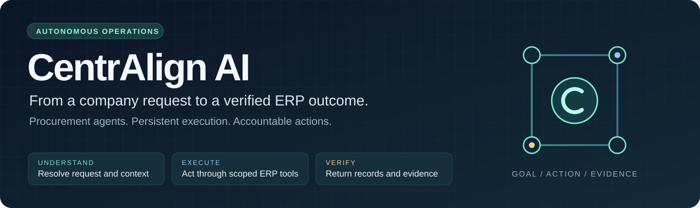
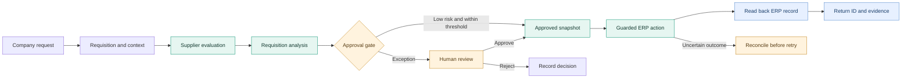
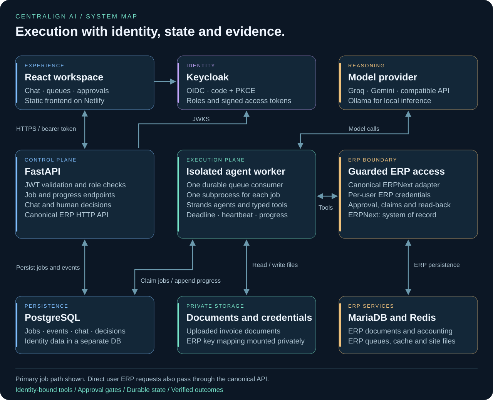

<p align="center">
  
</p>

<p align="center">
  <a href="#how-it-works">Workflow</a> ·
  <a href="docs/ARCHITECTURE.md">Architecture</a> ·
  <a href="#what-is-implemented">Implementation</a> ·
  <a href="#run-locally">Get started</a> ·
  <a href="docs/STATUS.md">Validation</a>
</p>

# CentrAlign AI

**An AI operator that moves procurement from a company request to a verified ERP outcome.**

Company work spans requests, supplier records, approvals, receipts and invoices. CentrAlign AI gives that work a persistent execution loop: understand the request, retrieve company context, reason about the next action, use a permitted tool, inspect the result and return evidence.

The working scope is procurement. Specialized agents evaluate suppliers, analyze requisitions and generate purchase orders. People review exceptions and confirm invoice creation and payments. Every ERP operation uses the acting user's credentials.

`React + TypeScript` · `FastAPI` · `Strands` · `PostgreSQL` · `Keycloak` · `ERPNext` · `Docker` · `Netlify`

## How it works

> **Example outcome:** “Restock safety equipment for Manufacturing. Evaluate the suppliers, route any exceptions for approval, and return the purchase order.”

Chat supports natural-language procurement requests. The execution workflow starts from a requisition ID and handles the sourcing, analysis, approval and PO stages. It returns a verified record or a specific blocking condition.



## System architecture

[](docs/ARCHITECTURE.md)

The API records jobs and serves progress. A persistent worker runs each job in its own process, calls the configured model and exposes typed ERP tools. PostgreSQL retains execution state; ERPNext remains the system of record. The frontend polls the backend directly, allowing work to continue after a browser request ends.

[Explore the components, sequence diagrams and failure states →](docs/ARCHITECTURE.md)

## What is implemented

| Capability | Behavior | Code |
| --- | --- | --- |
| Natural-language intake | Procurement chat with role context and stored conversations | [Chat agent](backend/agents/chat_agent.py) |
| Multi-agent execution | Sourcing → requisition analysis → approval → PO generation | [Workflow](backend/agentcore_app.py) |
| Persistent jobs | Owner-scoped queue, progress events, heartbeats and interrupted-job locks | [Job runtime](backend/runtime/jobs.py) |
| Process isolation | A separate process for each job, with a runtime deadline | [Worker](backend/runtime/worker.py) |
| Identity and permissions | Verified OIDC tokens, application roles and per-user ERP credentials | [Authentication](backend/services/auth.py) |
| Protected ERP actions | Approval snapshots, amount checks, duplicate-write claims and PO read-back | [Write boundary](backend/services/write_policy.py) |
| Invoice handling | PDF/OCR extraction → reviewable proposal → explicit confirmation → ERP read-back | [Invoice API](backend/api/invoices.py) |
| Tool constraints | Typed operations and a restricted arithmetic evaluator | [Agent tools](backend/runtime/tools.py) |
| Execution evidence | Stored decisions, progress, ERP record IDs and workflow history | [Lifecycle](backend/services/lifecycle.py) |
| Repeatable setup | Docker services, identity/ERP bootstrap, private secrets and backup commands | [Deployment](compose.yaml) |

The [implementation guide](docs/IMPLEMENTATION.md) maps these capabilities to their boundaries and tests.

## Agent responsibilities

| Agent | Responsibility | Action boundary |
| --- | --- | --- |
| Chat | Understand a request, retrieve records and help create requisitions | Role-scoped HTTP tools |
| Sourcing | Compare suppliers and recommend an award | Read-only analysis |
| Requisition | Check request details, risk, duplicates and pricing | Recommendation and approval gate |
| PO management | Turn an approved requisition into a purchase order | Writes enabled only in the workflow PO stage |
| Receiving | Inspect delivery and receipt evidence | Read-only analysis |
| Invoice matching | Compare invoice, PO and goods receipts | Read-only analysis |
| Payment | Analyze amount, timing and discount options | Payment creation requires a separate human action |

## Run locally

**Prerequisites:** Python 3.13, Node.js 22, Docker and Compose v2 with `include` support.

```sh
# Create private configuration and random service credentials.
make init
# Add your own model key to the root .env, then start Docker.
make bootstrap
```

The first bootstrap pauses for the ERPNext company setup wizard. Complete it using the [setup guide](docs/NETLIFY_DEPLOYMENT.md), then rerun `make bootstrap`.

```sh
cp frontend/.env.example frontend/.env
npm ci --prefix frontend
npm run dev --prefix frontend
```

Supported model configurations: `groq`, `gemini`, `openai-compatible` and `ollama`. Keys stay on the backend. The example company and fixture data provide a bounded environment for testing.

## Engineering checks

```sh
python3 -m venv .venv
.venv/bin/pip install -r backend/requirements-dev.txt
make test
npm ci --prefix frontend
npm run build:netlify --prefix frontend
docker compose --env-file .env.example config --quiet
```

**18 backend tests pass locally**, including authentication, job ownership, real subprocess execution, failed worker startup, duplicate writes, changed approval snapshots, fabricated PO completion and invoice review. These tests use temporary SQLite and controlled ERP/model boundaries.

The TypeScript/Vite frontend build passes locally; a full live ERP/model workflow still needs validation. Deployment files target Netlify for the frontend and a persistent Docker host for the backend; no live application deployment is claimed. See [validation status](docs/STATUS.md) and [deployment instructions](docs/NETLIFY_DEPLOYMENT.md).

## Repository map

```text
backend/
  agents/           Domain reasoning and prompts
  api/              Chat, jobs, reviews, decisions and progress
  runtime/          Durable queue, isolated runner and typed tools
  adapters/         Canonical ERP contracts and ERPNext integration
  services/         Identity, SQL state, documents and write checks
  tests_portable/   Runtime and reliability checks
frontend/           React workspace and public deployment configuration
deploy/             ERP services, identity database and HTTPS proxy
scripts/            Private configuration, bootstrap and backups
utilities/data/     Example suppliers, items, requisitions and budgets
docs/               Architecture, implementation and validation evidence
```

Historical deployment material is separate from the active `compose.yaml` and `netlify.toml` path.

## Scope

The prototype supports one complete PO per requisition. Split awards, receipt returns and invoices spanning multiple POs need manual handling. Model risk scores are advisory. The operator currently acts through ERP APIs; general browser and desktop automation are outside this implementation.

## License and notices

[MIT-0 license](LICENSE) · [Dependency notices](THIRD-PARTY-LICENSES.md) · [Source origin](UPSTREAM.md)

## Prepare and demonstrate

Run `make preflight` to check local prerequisites and private configuration without printing credentials. Add `python3 scripts/preflight.py --docker` when the Docker engine is available. Configuration presence is not a live connectivity test.

The public `/architecture` page is available before sign-in, so a Netlify frontend preview can explain the system while backend provisioning is pending. Business operations continue to require authentication. See the [demo runbook](docs/DEMO_RUNBOOK.md) and [frontend publishing checklist](docs/FRONTEND_PUBLISHING.md).
