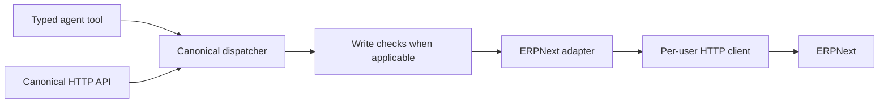

# Canonical ERP interface

The adapter exposes procurement concepts such as suppliers, requisitions, purchase orders, receipts, invoices and payments through typed models. ERPNext is the implemented backend.

Read operations can dispatch directly to the adapter. PO and payment writes are routed through deterministic checks. Each user resolves to an exact-email entry in a private credential mapping; an unprovisioned caller is rejected.

| Module | Purpose |
| --- | --- |
| `models.py` | Canonical data and input schemas; non-finite amounts rejected |
| `erp_adapter_base.py` | ERP operation interface |
| `canonical_api.py` | Mounted FastAPI endpoints and shared typed dispatcher |
| `erpnext/field_maps.py` | ERP field translation |
| `erpnext/client.py` | Bounded HTTP calls and document operations |
| `erpnext/oauth.py` | Per-user API credential lookup |
| `erpnext/adapter.py` | ERPNext procurement operations and record reads |

Other ERP backends are extension points, not implemented integrations. See [write controls](../../docs/ARCHITECTURE.md#approval-and-write-boundary).
