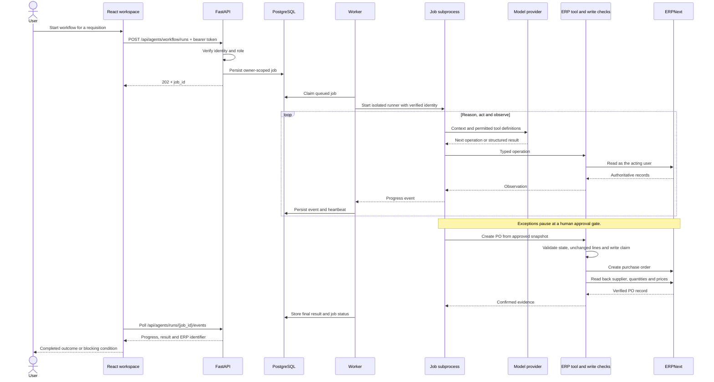
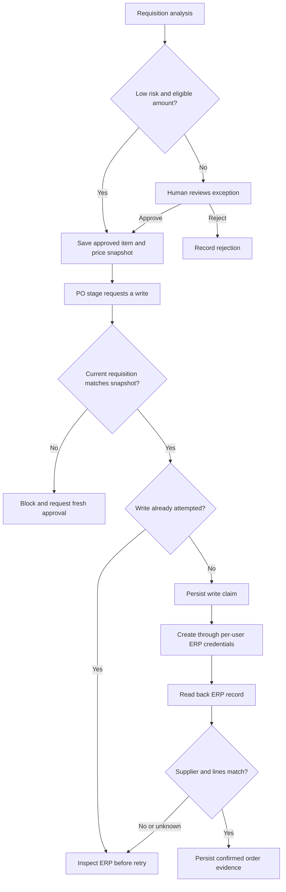
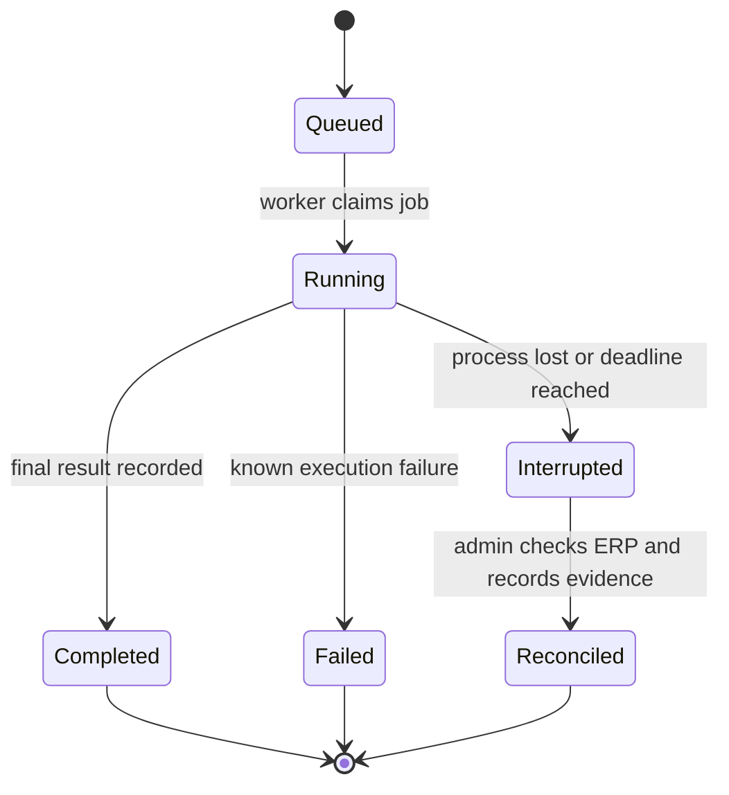

# CentrAlign AI — system architecture

The operator separates user intent, execution and verification. The browser presents requests and decisions. FastAPI establishes the caller's identity and records work. A durable worker performs agent execution. The canonical adapter turns typed operations into ERPNext calls.

## Component boundaries

| Component | Owns | Does not own |
| --- | --- | --- |
| React workspace | Chat, request queues, approval controls, progress and evidence views | Model keys, ERP credentials or authorization decisions |
| Keycloak | OIDC identity, signed tokens, roles and department claims | ERP accounting permissions |
| FastAPI | JWT validation, role checks, HTTP interfaces and job creation | Background job execution inside a request |
| PostgreSQL | Jobs, events, conversations, decisions, lifecycle and write claims | ERP accounting as a second system of record |
| Worker | Queue consumption, heartbeat, process deadline and durable events | Unlimited concurrency or automatic replay of uncertain writes |
| Per-job runner | Agent reasoning, context and permitted tool execution | A shared mutable agent instance across jobs |
| ERP adapter | Canonical schemas, per-user HTTP credentials and ERP operations | Escalating to a broad service account when credentials are missing |
| ERPNext | Procurement records, accounting rules and ERP permissions | The model's narrative of whether work succeeded |

The deployed database configuration uses PostgreSQL. SQLite is used for local tests. Keycloak stores its identity data in a separate database on the same PostgreSQL service. ERPNext uses MariaDB, Redis and site volumes.

## A procurement job, end to end

The diagram shows the background workflow. Chat currently runs synchronously through the API. Agents use a local typed dispatcher for ERP access; direct user actions and invoice processing can use the mounted canonical HTTP API. This implementation does not require an MCP gateway.

## Approval and write boundary

Approval snapshots cover item identifiers, quantities and approved unit prices. They are not a full enterprise policy engine or an atomic ERP version lock. The PO boundary accepts all approved items once, with unchanged quantities and prices no higher than approved rates. Amounts above 50000 require the application admin role in addition to ERP permissions.

## Failure and recovery

A completed job can contain an `AWAITING_APPROVAL` workflow result; that means the analysis job ended, not that a PO was created. A later approved resume starts another job. The UI must distinguish job state from the business outcome.

An interrupted job retains its document lock. Admin reconciliation releases that job lock only. Permanent ERP write claims remain until the uncertain ERP outcome is resolved. The worker never blindly replays an ambiguous write.

## Invoice and payment path

Extraction confidence is not calibrated, so extracted values always require human review. Payment checks use authoritative ERP records rather than client-supplied analysis. The accounting transaction is recorded in ERPNext; no external bank transfer integration is implemented.

## Deployment boundary

Netlify serves static frontend assets. Requests go directly to a separate HTTPS API; browser polling avoids coupling job duration to a frontend request. Docker Compose defines FastAPI, a single worker, identity, ERP services and persistent data. The optional Caddy profile terminates public HTTPS for API and identity hostnames.

See [deployment](NETLIFY_DEPLOYMENT.md), [implementation evidence](IMPLEMENTATION.md) and [validation status](STATUS.md).

## Quote-backed execution demonstrated locally

The verified path uses the model for supplier selection and requisition assessment,
then pauses for explicit human approval. The approved quote binds supplier, rates,
terms and delivery date. A typed executor creates that exact PO without another
model request, and the write boundary independently reads the ERP record back.
This reduces provider exposure after the commercial decision is already fixed.
The model-planned PO path remains available for cases without a quote snapshot.
See [the local evidence](evidence/2026-10-26-procurement.json).
