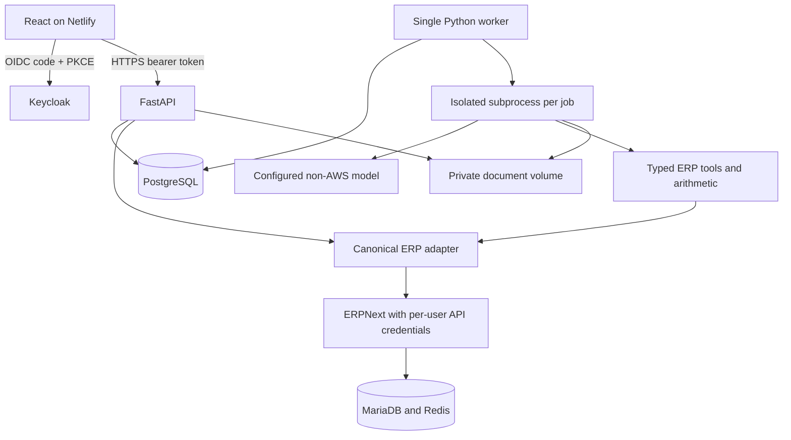

# Portable migration and verification boundary

## Active architecture

The worker runs **one replica**. Every job stores its verified identity, input and append-only progress events; tokens and model keys are not stored in the job payload. Each job gets a separate process to isolate agent globals and allow a hard execution deadline. Browser polling avoids Netlify request duration and streaming constraints.

## Replacements

| Original service | Portable implementation | Material difference |
| --- | --- | --- |
| Frontend AWS hosting | Netlify static Vite build | Requires separate backend URL |
| Bedrock | Explicit Strands Groq / Gemini / compatible endpoint / Ollama provider | Model quality and quotas must be evaluated |
| AgentCore Runtime | Persistent SQL queue + Python worker subprocesses | Single worker; no managed scaling or lease fencing |
| AgentCore Gateway | Typed local ERP tool dispatcher and canonical HTTP API | This is not a self-hosted MCP server |
| Cognito | Keycloak OIDC, authorization code + PKCE | Self-hosted identity must be maintained |
| DynamoDB / AgentCore Memory | PostgreSQL records, jobs, events and chat | Stores conversation/workflow context; no semantic long-term memory extraction |
| S3 | Private persistent volume with generated document keys | Single host; no object-store replication/lifecycle policy |
| Textract | PDF text extraction / Tesseract OCR + model JSON extraction | No calibrated confidence score; human review is mandatory |
| Code Interpreter | Restricted arithmetic AST evaluator | No arbitrary Python, package installation or external side effects |
| Cedar / Automated Reasoning | Verified roles and deterministic write checks | No formal proof or semantic policy equivalence |
| CloudWatch | Container logs and SQL event history | No hosted monitoring or alerting |

Strands installs some AWS SDK dependencies transitively. The active application explicitly selects non-AWS model providers and does not call AWS services or need AWS credentials. Legacy AWS source remains for provenance.

## Completion and write controls

- Role claims are accepted only after verifying JWT signature, issuer, audience and expiry. User identity is never selected by request body or browser identity headers.
- Agent ERP writes are allowed only in the PO stage. Analysis agents cannot create invoices, receipts or payments through the generic tool.
- A PO requires approved lifecycle state, an unchanged approved item/quantity/price snapshot, all approved items exactly once, matching quantities, and prices no higher than approved prices.
- One persistent write claim covers the entire requisition. A different supplier cannot be used to replay the same request.
- PO success requires a tool-created record and a separate ERP read of its supplier and line values. Workflow completion is grounded in that evidence rather than the model's order ID.
- Invoice upload stops at `needs_review`. Only its owner can confirm the saved proposal. A permanent attempt claim prevents automatic replay after an ambiguous response, and the created invoice is read back.
- Payment creation checks the ERP invoice, PO, accepted receipts, other active invoices and outstanding amount. It supports a limited price tolerance and eligible early payment discount. Values above 50000 require the admin role. ERPNext's own permissions and accounting checks still apply.
- An interrupted job retains its document lock. Admin reconciliation releases that job lock; it does **not** release permanent ERP write claims.

## Limits that need live validation or further engineering

- Frontend dependency installation and compilation are blocked by npm registry timeouts; its migrated code has not yet passed a TypeScript/Vite build. Regenerate and commit the frontend lockfile before publishing.
- Docker services, ERP setup, live OIDC, OCR binary and external model calls have not been validated end to end in this environment. Start with synthetic company data.
- No strictly free always-online host for this complete stack has been selected. Netlify alone cannot run it.
- The prototype supports one complete PO per requisition. Split awards, repeated/partial PO allocations, multiple-PO invoices and receipt returns require manual procurement.
- Approved snapshots cover item identifiers, quantities and prices. They do not implement a full enterprise approval policy, supplier authorization, multi-currency approval limits or immutable ERP version locking.
- Auto-approval uses the model's risk assessment, a server-grounded amount, and a low-value threshold. It is not a formal safety guarantee. Disable it for real company data until evaluation and deterministic business rules are sufficient.
- Tool-call limits apply to an ERP tool instance; the subprocess deadline provides the overall runtime cap. Chat runs synchronously on the backend. Rate limits are per API process, not a distributed quota.
- SQL lifecycle records use some whole-record updates inherited from upstream. The single worker avoids concurrent agent jobs, but a human decision racing another lifecycle update needs stronger optimistic concurrency for production.
- Jobs and private uploads need a retention policy. The legacy `ttl` field is metadata; PostgreSQL does not automatically delete records from it.
- There is no unattended ERP write retry following an unknown outcome. Reconciliation requires an operator; permanent claims intentionally remain until ERP is inspected.
- The original fixed demo contracts are fixtures. Expired contracts are no longer returned as active. Demo data is not live organizational knowledge.
- Backups and restore procedures need a restore drill before any deployment that matters. Use exact container image digests and assess resource requirements on the chosen host.
