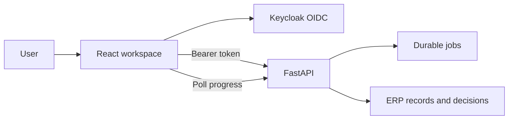

# CentrAlign AI workspace

React and TypeScript provide the operator's workspace: procurement chat, requisitions, suppliers, purchase orders, receipts, invoices, approvals, progress and evidence.

## Data flow



The frontend uses authorization code + PKCE. Browser role checks control navigation; backend verification and ERP permissions authorize actual actions. Agent work runs on a persistent backend and is observed through job polling.

## Local development

From the repository root:

```sh
cp frontend/.env.example frontend/.env
npm install --prefix frontend
npm run dev --prefix frontend
```

Public configuration consists of `VITE_API_URL`, `VITE_OIDC_AUTHORITY` and `VITE_OIDC_CLIENT_ID`. Model keys, ERP credentials and database passwords belong on the backend.

## Build and Netlify

`npm run build:netlify --prefix frontend` checks public configuration, runs TypeScript and builds Vite assets. Root `netlify.toml` sets base `frontend` and publish `dist`. API and identity need their own public HTTPS hostnames for a working deployment.

The Architecture page displays the same system map as the repository. The source diagram is `docs/assets/centralign-architecture.svg`; its public copy is `frontend/public/architecture.svg`.

[Architecture](../docs/ARCHITECTURE.md) · [Deployment](../docs/NETLIFY_DEPLOYMENT.md) · [Validation](../docs/STATUS.md)
